Отчет о проделанной работе с шагами

0. Login to Git acc

Оценка 3:

1. Used command git status

2. Describing git log command
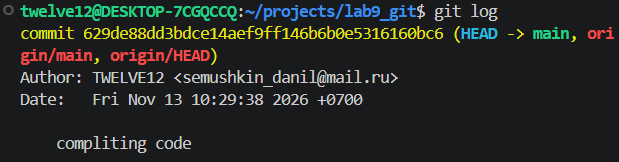

3. Created file with name sort.c

4. Git status output
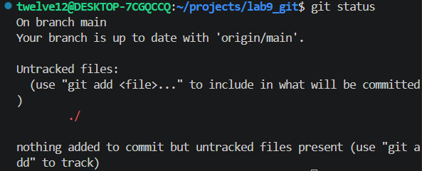

5. One file was moved to staged changes

6. Git status output
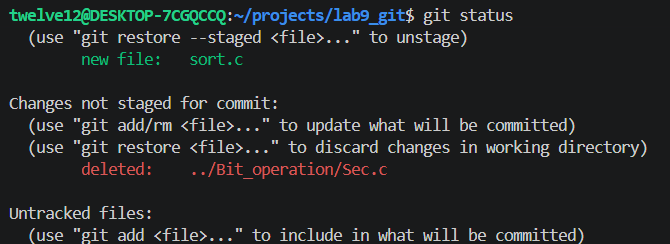

7. Commit Sort.c with text: "Added a random Sort algoritm"

8. Git status output

9. Change file with name sort.c by adding a comment with random text

10. Git status output

11. Add changed file with command git add

12. Git status output
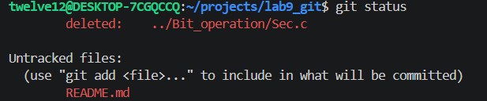

13. Git status output 
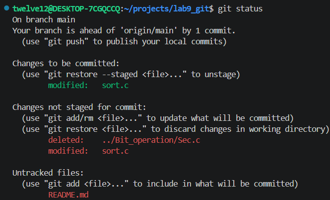

14. Commit changed sort.c file 

15. Git status and log output

to log was added 2 or 3 paragraph with changes in folder and by who it was made

16. Used command git push
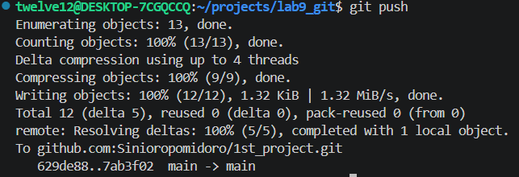

BRANCHES

1. Used command git branch mybranch

2. Used git branch 

3. Used git switch mybranch 

1-3 

4. Git status output

5. Check what i'm in right branch

6. Maked 2 new files with names file1.txt wich
include my name

7. Add file and commit it
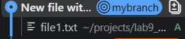

8. Used command git log with parametres --online and --graph

9. switch branch to master(main)
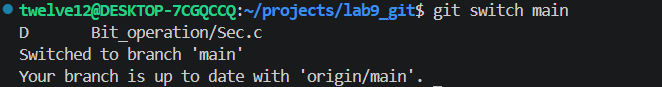

10. Used command git log with parametres --online and --graph

11. Added new file with hame file2.txt and commited

12. Used command git log with parametres --oneline --graph --all
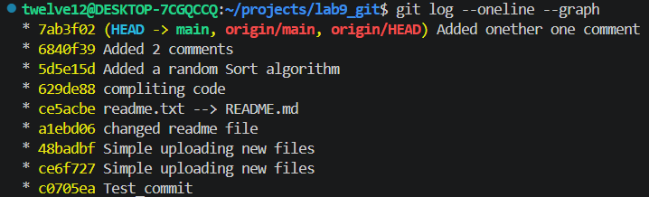

13. Branch main switched to mybranche

14. Наш file2.txt пропал?
и да и нет

15. Used command git diff mybranch main
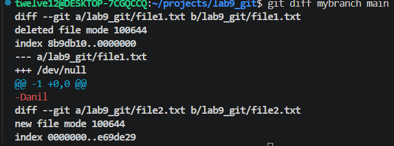

16. Commited all screenshots and README.md file

#Будет на один комит больше т.к. забыл подгрузить самый последний скрин + 17. запушены изменения в ветке main 

Оценка 4:

1. Branch main switched to mybranch 

2. Changes with massive on sort.c file 

3. Used command git diff to see changes
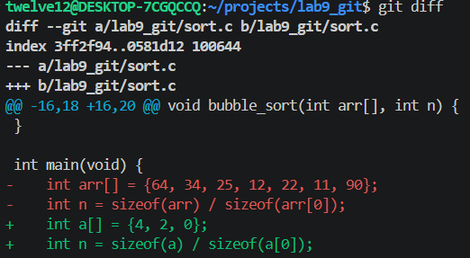

4. git diff --staged output:
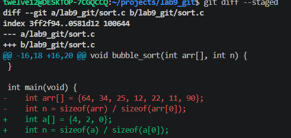

5. sort.c added to staged
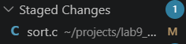  

6. git diff output info about readme file
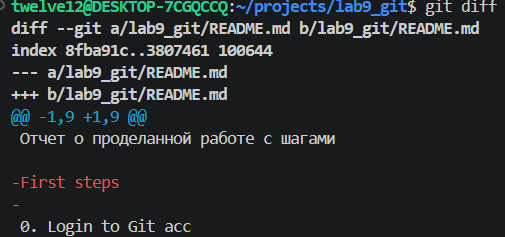

7. git diff --staged output info about file in staged changes
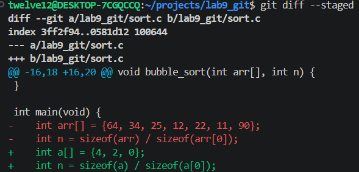

8. From sort.c removed one numb into array 

9. git diff output info about all changes
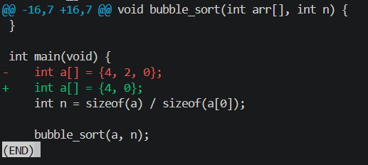

10. git cnahges --staged output info about all staged changes (changes into array)
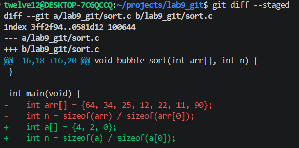

11. Discribe what's happening:
I'm just doing 9th lab

12. git status output:
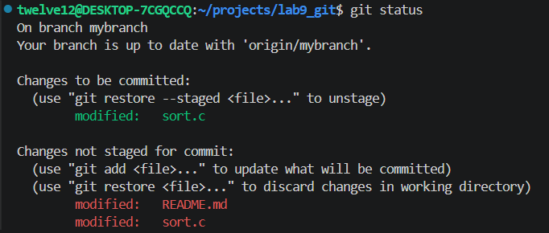

13. Used command git resore --staged sort.c

14. git status output:
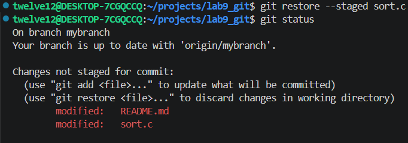

15. Added changes and commit was made
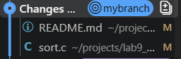

16. How does journal looks, by output command git log
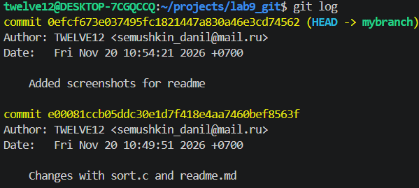

17. Added printf("hello git\n"); to main() in file sort.c

18. File sort.c still include sort func and now greetings to git had added

19. git status output:
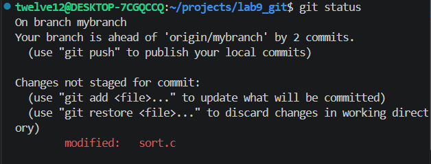

20. Used command git restore sort.c
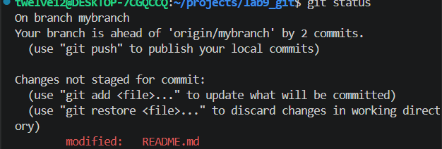

21. sort.c still include sort func and greetings to git

22. git status output 
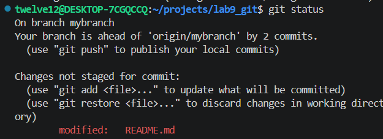

23. git pushed

Branches and ff-merge

1. Made file greeting.txt, index and commit it with message “Add file greeting.txt”
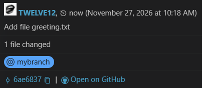

2. Add word hello to file, index and cimmit it with message "Add content to greeting.txt"
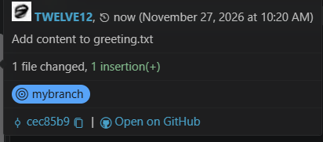

3. 4. Made new branch with name feature/uppercase
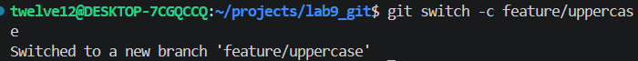

5. git satus output
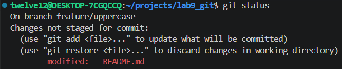

6. changed hello to HELLO in file greeting.txt

7. Add and commit changes with greeting.txt
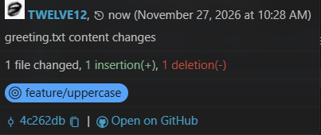

8. Git branch output
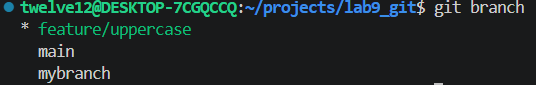

9. git log --online --graph --all output
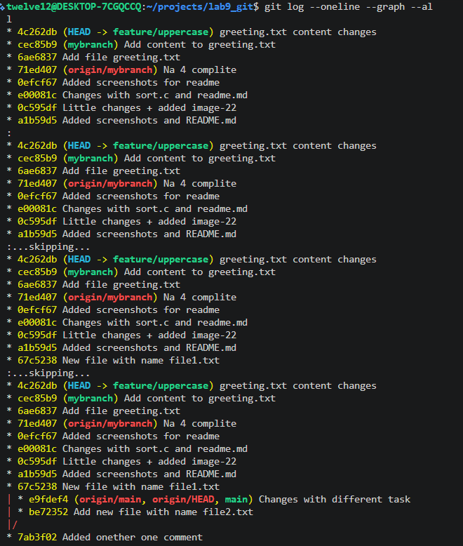

10. Switch to main branch #README.md was commited for it
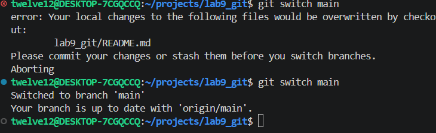

11. used cat to see content of greetings.txt
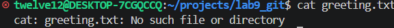

12. Look for diffs between main and feature/uppercase branches
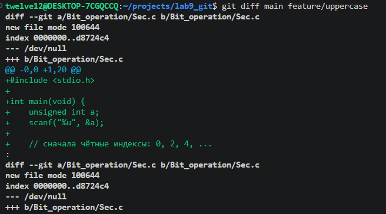

13. Merge branches 
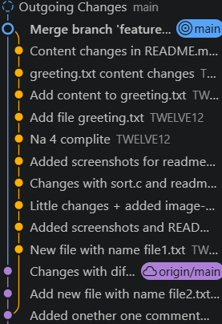

14. Use cat to see greeting.txt content
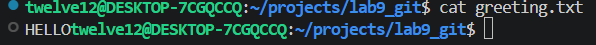

15. Delete feature/uppercase branch
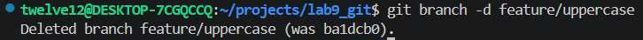

16. Merge mybranch and main #already was made
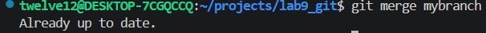

17. git log --oneline --graph --all output
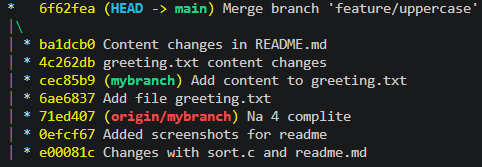

18. 