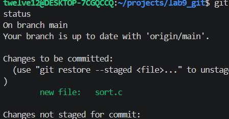
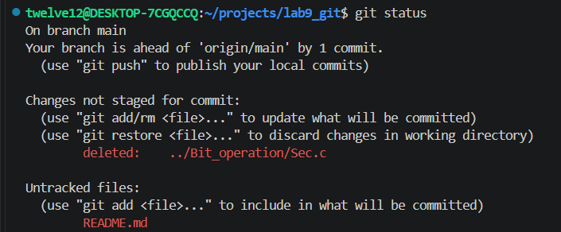
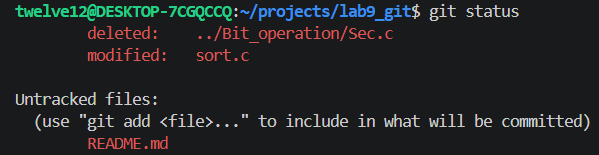
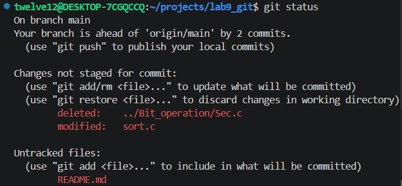
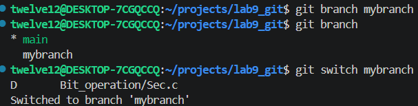
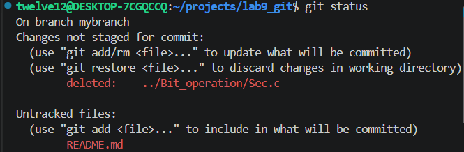
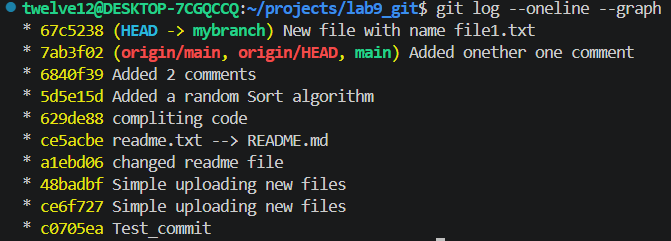
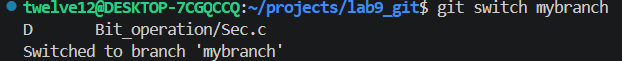

Отчет о проделанной работе с шагами

First steps

0. Login to Git acc

1. Used command git status

2. Describing git log command

3. Created file with name sort.c

4. Git status output

5. One file was moved to staged changes

6. Git status output

7. Commit Sort.c with text: "Added a random Sort algoritm"

8. Git status output

9. Change file with name sort.c by adding a comment with random text

10. Git status output

11. Add changed file with command git add

12. Git status output

13. Git status output 

14. Commit changed sort.c file 

15. Git status and log output

to log was added 2 or 3 paragraph with changes in folder and by who it was made

16. Used command git push

BRANCHES

1. Used command git branch mybranch

2. Used git branch 

3. Used git switch mybranch 

1-3 

4. Git status output

5. Check what i'm in right branch

6. Maked 2 new files with names file1.txt wich
include my name

7. Add file and commit it

8. Used command git log with parametres --online and --graph

9. switch branch to master(main)

10. Used command git log with parametres --online and --graph

11. Added new file with hame file2.txt and commited

12. Used command git log with parametres --oneline --graph --all

13. Branch main switched to mybranche

14. Наш file2.txt пропал?
и да и нет

15. Used command git diff mybranch main

16. 